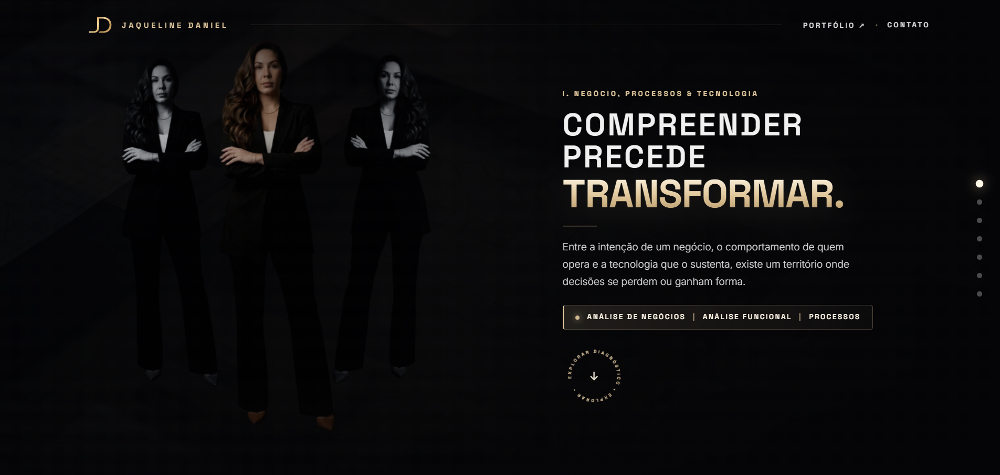

<div align="center">

<h1>
    JAQUELINE DANIEL
</h1>

### Análise de Negócios · Análise Funcional · Processos

> *"Compreender precede transformar."*

[](https://www.jaquelinedaniel.com)
[](https://github.com/jaquelinedaniel-pt)
[](https://linkedin.com/in/jaquelinedaniel-pt)

<br>



</div>

---

## Visão Geral

Repositório oficial do site pessoal e posicionamento profissional de **Jaqueline Daniel**, concebido sob direção de arte editorial minimalista.

Em vez de apresentar listas genéricas de ferramentas fora de contexto, a arquitetura da página conduz a leitura em sete atos progressivos, do diagnóstico de falhas operacionais ao método de investigação, princípios de decisão, evidências aplicadas em campo e teses autorais.

---

## Arquitetura Narrativa (7 Seções)

| Ato | Seção | Âncora | Papel Estratégico e Interação |
| :--- | :--- | :--- | :--- |
| **I** | **Hero em 2 Atos** | `#home` | Abertura tipográfica monumental com transição coreografada para o painel editorial, faixa de especialidade (*teste dos 5 segundos*) e acesso direto ao portfólio. |
| **II** | **A Anatomia do Erro Operacional** | `#about` | Carrossel contínuo em vidro espacial com controle manual de pausa/retomada e modais de diagnóstico (`Sintoma`, `Causa Raiz` e `Critério de Resolução`). |
| **III** | **Critérios de Atuação** | `#hub` | Navegação por abas acessíveis com painel dinâmico estruturado em três camadas (`Cenário`, `Como Atuo` e `O que isso gera`). |
| **IV** | **Princípios que Orientam a Decisão** | `#ecosystem` | Pilha isométrica 3D interativa com cinco regras de conduta operacional e o impacto real quando cada princípio falha. |
| **V** | **Evidências Aplicadas** | `#proof` | Síntese de lastro comercial e técnico seguida de quatro dossiês auditáveis em gaveta lateral (*slide-over drawer*): Stilus, DouroVinhos, WinWin e Formação Acadêmica. |
| **VI** | **Critério em Estado Puro** | `#articles` | Galeria 3D em arco (*coverflow*) com leitor editorial em modal, barra de progresso de leitura e chamada contextualizada por tese. |
| **VII** | **Contato** | `#contact` | Canal direto via modal com cópia de e-mail em um clique, validação de formulário e disparo estruturado para o cliente de e-mail. |

---

## Sistema Visual & Tipografia

O projeto adota uma paleta escura de alto contraste inspirada em publicação editorial executiva, calibrada para conforto de leitura e conformidade **WCAG 2.2 AA**:

| Token | Hex | Aplicação |
| :--- | :--- | :--- |
| **Obsidiana Base** | `#050507` | Fundo principal e fusão contínua entre seções |
| **Champagne Bright** | `#FFF7E8` | Pontos de luz especular, títulos em destaque e estados ativos |
| **Champagne Mid** | `#E2C99E` | Kickers, filetes arquitetônicos, indicadores e bordas ativas |
| **Champagne Deep** | `#B59868` | Base dos gradientes metálicos escovados |
| **Text Muted** | `#B4B8C5` | Textos de apoio e descrições secundárias (contraste `> 4.5:1`) |

* **Tipografia de Display:** `Space Grotesk` (títulos monumentais, rótulos técnicos e controles).
* **Tipografia Editorial:** `Inter` (corpo de texto fluido e leitura prolongada).

---

## Decisões de Engenharia Front-end

Desenvolvido em **Vanilla Stack (HTML5, CSS3, ES6+)** sem frameworks pesados para garantir controle granular de renderização, zero dependências externas e carregamento imediato:

* **HTML5 Semântico & SEO:** Hierarquia estrita de headings (`h1` único na Hero, `h2` por seção, `h3` em componentes), atributos ARIA (`tablist`, `tab`, `tabpanel`, `dialog`), Open Graph, Twitter Cards e dados estruturados `JSON-LD` (`Schema.org/Person`).
* **CSS3 Arquitetônico:** Design System centralizado em Custom Properties (`:root`), escalas fluidas com `clamp()`, CSS Grid/Flexbox, profundidade 3D (`perspective`, `transform-style: preserve-3d`), superfícies translúcidas (`backdrop-filter`) e breakpoints para `320px`, `375px`, `768px` e desktop.
* **JavaScript Modular & UX:** Gerenciamento de estado para modais, drawers, abas, carrossel 3D com suporte a *swipe* tátil, *scroll spy* na navegação lateral e cópia de e-mail via `navigator.clipboard` com fallback.
* **Acessibilidade (WCAG 2.2):** Navegação integral por teclado (`Tab`, setas direcionais, `Enter`, `Space`, `Escape`), *focus trap* com retorno automático de foco ao fechar qualquer modal ou gaveta, indicadores `:focus-visible` e suporte nativo a `@media (prefers-reduced-motion: reduce)`.

---

## Estrutura de Diretórios

```text
├── assets/
│   ├── JD_champagne.svg                        # Monograma oficial (modo escuro e rodapé)
│   ├── JD_carvao.svg                           # Monograma adaptativo (favicon modo claro)
│   ├── JD_dourado_referencia_transparente.png  # Monograma da barra superior
│   ├── hero.png                                # Retrato principal da Hero
│   ├── background_hero.png                     # Blueprint técnico de fundo (Seção I)
│   ├── section_2.png                           # Fundo técnico (Seção II)
│   ├── section_3.png                           # Fundo cênico (Seção III)
│   ├── section_4.png                           # Fundo isométrico (Seção IV)
│   ├── section_5.png                           # Fundo documental (Seção V)
│   ├── section_6.png                           # Fundo editorial (Seção VI)
│   ├── section_7.png                           # Fundo da sala de decisão (Seção VII)
│   └── preview-hero.png                        # Captura da Hero em produção para o README
├── index.html                                  # Estrutura semântica, SEO e modais
├── style.css                                   # Design System, animações e responsividade
├── script.js                                   # Interações, dados dos dossiês e acessibilidade
└── README.md                                   # Documentação técnica do repositório
```


## Repositórios Relacionados

> **[`dourovinhos-mobile-sales`](https://github.com/jaquelinedaniel-pt/dourovinhos-mobile-sales)** — **Análise Funcional & Arquitetura Offline-First**  
> Especificação funcional completa (BPMN 2.0, SRS, Gherkin e plano UAT) e protótipo MVP construídos a partir de um cenário real de distribuição de vinhos em campo.

> **[`winwin-product-portfolio`](https://github.com/jaquelinedaniel-pt/winwin-product-portfolio)** — **Product Discovery & Critério de Corte**  
> Documentação de discovery, regras de negócio (economia dual-token e Lazy Audit) e decisão consciente de encerramento de produto próprio.

---

<br>

<div align="center">


<br><br>

**Análise de Negócios · Análise Funcional · Processos**  
Porto, Portugal

<br>

[](https://www.jaquelinedaniel.com)
[](https://linkedin.com/in/jaquelinedaniel-pt)
[](mailto:jaquelinedaniel.pt@gmail.com)

</div>